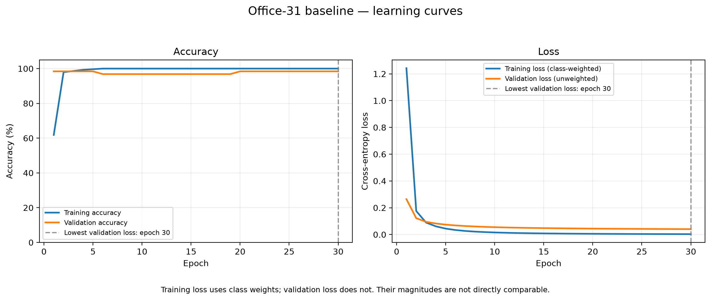

# PDE3802 Office Classifier

Group coursework for Artificial Intelligence in Robotics at Middlesex University Mauritius.

## Team

- Khrisvin Nepaulsing — M01003462
- Veedoor Gopal
- Pranay Poheith

## Project overview

This project implements single-item image classification using MobileNetV2 pretrained on ImageNet as a frozen feature extractor and a trainable six-class classification layer.

The current Office-31 model recognises:

- bottle
- calculator
- keyboard
- mouse
- mug
- stapler

The original personal-photo pilot used book instead of calculator. Its dataset, models and results are preserved separately.

The implementation predicts a class for an entire image. It does not locate objects, separate multiple items, navigate or control a robot. The wider proposed robot design is a separate coursework component.

## Recorded results

| Dataset and experiment | Split | Correct / total | Accuracy | Macro F1 |
|---|---|---:|---:|---:|
| Personal-photo baseline | Validation | 23/30 | 76.67% | 0.7286 |
| Personal-photo augmentation | Validation | 22/30 | 73.33% | 0.7063 |
| Selected personal-photo baseline | Test | 15/30 | 50.00% | 0.4850 |
| Office-31 baseline | Validation | 62/63 | 98.41% | 0.9872 |
| Office-31 baseline | Test | 59/61 | 96.72% | 0.9744 |

The Office-31 and personal-photo test scores are not directly comparable. They use different images, class sets, split methods and capture conditions.

The Office-31 result measures performance on a reviewed subset of Amazon product photographs. It does not establish accuracy on real office scenes.

Both test sets have now been evaluated and inspected. Neither should be described as untouched in future model development.

## Setup on Windows

Install Git and uv, then run these commands in PowerShell:

```powershell
git clone https://github.com/khrisvin/PDE3802-Office-Classifier.git
cd PDE3802-Office-Classifier

uv venv --python 3.12 .venv
uv pip install --python .\.venv\Scripts\python.exe -r requirements.txt
```

For an existing checkout, run the environment commands from its project folder.

The commands below use the virtual environment's interpreter directly, so activation is optional.

The recorded experiments used TensorFlow 2.21.0 on CPU. Package versions are recorded in `requirements.txt`.

## Restore the Office-31 dataset

Downloaded Office-31 photographs and their generated copies are excluded from Git. The manifests, review decisions and restoration script are included.

Download `Dataset_Office-31.tar.gz` from the source used for this project:

https://zenodo.org/records/14751811

Extract the archive and place its folders so that this example path exists:

```text
data/external/office31/amazon/images/bottle/frame_0003.jpg
```

The archive also contains DSLR and webcam domains. This experiment uses only Amazon images.

Run:

```powershell
& ".\.venv\Scripts\python.exe" restore_office31_dataset.py
```

The script reads the committed manifests and:

- Verifies the SHA-256 hashes of the 415 required original images.
- Restores missing clean and split image copies.
- Verifies existing copies rather than overwriting them.
- Rejects files whose hashes do not match.
- Preserves the recorded split assignments and experiment files.

When both destination image collections are missing, the expected output includes:

```text
Original images verified: 415
Existing image copies verified: 0
Missing image copies restored: 830
```

The 830 copies consist of 415 clean images and the same 415 images distributed across train, validation and test. They are not 830 independent examples.

On a subsequent successful run:

```text
Original images verified: 415
Existing image copies verified: 830
Missing image copies restored: 0
```

Missing-image restoration was exercised in a separate temporary directory.

Use this restoration script after cloning. The original construction scripts refuse existing destination directories, including directories already containing committed manifests.

## Office-31 dataset composition

The six selected Amazon categories originally contained 523 images. Review and duplicate exclusions removed 108 images, leaving 415.

| Class | Training | Validation | Test | Total |
|---|---:|---:|---:|---:|
| bottle | 17 | 3 | 3 | 23 |
| calculator | 63 | 14 | 14 | 91 |
| keyboard | 38 | 8 | 8 | 54 |
| mouse | 66 | 14 | 14 | 94 |
| mug | 49 | 12 | 10 | 71 |
| stapler | 58 | 12 | 12 | 82 |
| Total | 291 | 63 | 61 | 415 |

Recorded visual groups remain within one split. These groups represent visually related products, not verified physical-object identities.

No recorded group crosses splits. This does not prove that every unrecognised near-duplicate or related product has been identified.

See [DATASET_CARD.md](DATASET_CARD.md) for sources, review scope, grouping and limitations.

## Preprocessing and class order

Images are:

1. Read using OpenCV.
2. Resized proportionally and padded with black pixels to 224 × 224.
3. Converted from BGR to RGB.
4. Supplied to the model as pixel values in the range 0–255.

An internal model layer scales pixels to −1–1. Do not apply this scaling a second time.

| Numeric label | Office-31 model | Original pilot model |
|---|---|---|
| 0 | bottle | book |
| 1 | calculator | bottle |
| 2 | keyboard | keyboard |
| 3 | mouse | mouse |
| 4 | mug | mug |
| 5 | stapler | stapler |

Each experiment's `classes.json` records its output order. The models and class mappings must not be interchanged.

## Predict one image with the Office-31 model

The saved model is included, so retraining is unnecessary.

After restoring the dataset:

```powershell
& ".\.venv\Scripts\python.exe" predict_office31.py "data\office31_split\val\bottle\office31_amazon_frame_0013.jpg"
```

The recorded result is `bottle`, with a model score of approximately 99.30%.

To classify another image:

```powershell
& ".\.venv\Scripts\python.exe" predict_office31.py "C:\path\to\photo.jpg"
```

The program prints the predicted class and all six scores.

Use an image with one clearly visible target item. The classifier always selects one of its six classes; it has no unknown-object rejection mechanism.

Scores are not calibrated probabilities of correctness. A high score does not guarantee a correct prediction.

A recorded failure can be reproduced with:

```powershell
& ".\.venv\Scripts\python.exe" predict_office31.py "data\office31_split\val\mouse\office31_amazon_frame_0038.jpg"
```

This correctly labelled mouse was predicted as `stapler`, with a score of approximately 67.51%. The image was retained.

## Office-31 model and training

Architecture:

- ImageNet-pretrained MobileNetV2 without its original classification head.
- Frozen backbone, called in inference mode.
- Global average pooling.
- Dense layer with six softmax outputs.

Only the classification layer is trained: 1,280 × 6 weights plus 6 biases, giving 7,686 trainable parameters.

| Setting | Value |
|---|---|
| Optimiser | Adam |
| Learning rate | 0.001 |
| Loss | Sparse categorical cross-entropy |
| Batch size | 8 |
| Maximum epochs | 30 |
| Random seed | 42 |
| Early-stopping monitor | Validation loss |
| Patience | 5 epochs |
| Best weights restored | Yes |
| Augmentation | None |
| Training class weights | N / (6 × class training count) |

Class weights are calculated from the training split only. Training loss is class-weighted; validation loss is unweighted.

The recorded run completed 30 epochs. Epoch 30 had the lowest validation loss, approximately 0.0401, with 98.41% validation accuracy.

The training command is:

```powershell
& ".\.venv\Scripts\python.exe" train_office31.py
```

The script refuses to overwrite `outputs/office31_baseline/`. The recorded model already exists, so this command is not required for prediction or dataset restoration.

For a separate training experiment, use a separate checkout and a new output directory. Preserve the recorded model, configuration and evaluations. Downloading pretrained weights may be necessary for a new training run.

A fixed seed does not guarantee bit-identical training across platforms and library versions.

## Learning curves

Generate the Office-31 chart from its saved history:

```powershell
& ".\.venv\Scripts\python.exe" plot_office31_learning_curves.py
```

Output:

```text
outputs/office31_baseline/learning_curves.png
```

This does not retrain the model.

Training accuracy reached 100% at epoch 6. Validation accuracy finished at 98.41%, while validation loss continued decreasing.

Training and validation loss magnitudes are not directly comparable because only training loss uses class weights.



## Office-31 evaluation

Evaluation scripts load the saved model without retraining:

```powershell
& ".\.venv\Scripts\python.exe" evaluate_office31_validation.py
& ".\.venv\Scripts\python.exe" evaluate_office31_test.py
```

The result directories already contain the recorded evaluations. These scripts refuse to overwrite existing result directories.

For independent reproduction, use a separate checkout, preserve the existing results in a backup location outside their original directories, and run evaluation using the unchanged model and restored split.

The test script checks that the saved model and split-manifest fingerprints match the validation record.

Each evaluation produces metrics, a classification report, per-image predictions and a confusion matrix.

### Validation

- Images: 63.
- Correct: 62.
- Accuracy: 98.41%.
- Macro F1: 0.9872.
- Error: mouse `frame_0038` predicted as stapler.

### Test

| Class | Correct / total | Precision | Recall | F1 |
|---|---:|---:|---:|---:|
| bottle | 3/3 | 1.0000 | 1.0000 | 1.0000 |
| calculator | 14/14 | 1.0000 | 1.0000 | 1.0000 |
| keyboard | 8/8 | 1.0000 | 1.0000 | 1.0000 |
| mouse | 12/14 | 1.0000 | 0.8571 | 0.9231 |
| mug | 10/10 | 1.0000 | 1.0000 | 1.0000 |
| stapler | 12/12 | 0.8571 | 1.0000 | 0.9231 |

Overall accuracy: 96.72% (59/61). Macro F1: 0.9744.

Both test mistakes were mouse images predicted as stapler:

- `test/mouse/office31_amazon_frame_0036.jpg`
- `test/mouse/office31_amazon_frame_0079.jpg`

The model was not retrained or modified during this evaluation. Error causes have not been verified experimentally.

See [ERROR_ANALYSIS.md](ERROR_ANALYSIS.md).

## Original personal-photo pilot

The original dataset contains 90 personally captured images of 18 physical objects across six classes: book, bottle, keyboard, mouse, mug and stapler.

Each contributor photographed one distinct object per class from five views. All views of an object stay in one split.

Each split contains 30 images: five images of one physical object per class.

Original images are in `data/raw/`. To prepare the pilot after cloning:

```powershell
& ".\.venv\Scripts\python.exe" check_dataset.py
& ".\.venv\Scripts\python.exe" split_dataset.py
& ".\.venv\Scripts\python.exe" prepare_data.py
```

Run `split_dataset.py` only when `data/split/` does not already exist.

The baseline and rotation/zoom experiments are preserved in:

- `outputs/pilot/`
- `outputs/augmented_v1/`

The augmented run completed 28 epochs and selected epoch 23 by validation loss. Its validation accuracy was 73.33%, compared with 76.67% for the baseline. The baseline was selected before test evaluation.

The selected baseline achieved 50.00% test accuracy and 0.4850 macro F1. All five test stapler images were predicted as mouse.

These results demonstrate limited generalisation in the pilot. The tested augmentation settings did not improve the recorded validation run.

To use the original model:

```powershell
& ".\.venv\Scripts\python.exe" predict_image.py "data\split\val\book\pranay_book01_001.jpeg"
```

To plot its saved histories:

```powershell
& ".\.venv\Scripts\python.exe" plot_learning_curves.py
```

Historical training scripts are `train.py` and `train_augmented.py`. The original `train.py` can overwrite pilot artifacts; do not rerun it over the recorded experiment.

## Main Office-31 files

| File | Purpose |
|---|---|
| `prepare_office31.py` | Initial extraction review and duplicate reporting |
| `make_review_sheets.py` | Generate thumbnail sheets for visual review |
| `external_image_review.txt` | Record exclusions and visual groups |
| `exact_duplicate_exclusions.txt` | Record initial redundant image exclusions |
| `build_clean_dataset.py` | Construct the reviewed clean dataset |
| `split_office31.py` | Create the original recorded grouped split |
| `restore_office31_dataset.py` | Restore images from committed manifests |
| `train_office31.py` | Train the Office-31 baseline |
| `evaluate_office31_validation.py` | Evaluate validation images |
| `evaluate_office31_test.py` | Evaluate the fixed model on test images |
| `predict_office31.py` | Predict one image |
| `plot_office31_learning_curves.py` | Plot saved training history |
| `DATASET_CARD.md` | Document both datasets |
| `ERROR_ANALYSIS.md` | Document Office-31 errors and limitations |

The construction scripts document dataset development. Restoration is the normal setup route for the recorded dataset.

## Limitations

- Office-31 images are mainly product photographs, unlike cluttered office scenes.
- Visual groups are not verified physical-object identities.
- Undetected near-duplicates or related products may remain.
- Cleaning excluded some ambiguous and multi-item photographs, narrowing the evaluation scope.
- Classes are imbalanced; only three bottles are present in each evaluation split.
- There is no unknown-object rejection or score calibration.
- Classification does not establish localisation, navigation or grasping performance.
- Neither dataset demonstrates safe autonomous robot operation.
- Test results have been inspected and must not become targets for further tuning.

Future development should use broader capture conditions and reserve a fresh independent test set before making further model choices.

## Troubleshooting

- Missing package: install `requirements.txt` using the project interpreter.
- Missing Office-31 images: check the extracted archive path and run `restore_office31_dataset.py`.
- Hash mismatch: check the original archive and affected file; do not change the recorded hash just to bypass the check.
- Missing pilot split: run `split_dataset.py` once.
- Missing Office-31 model: check `outputs/office31_baseline/office_classifier.keras`.
- Existing experiment or evaluation directory: inspect its saved results and preserve them before conducting a separate run.
- A wrong prediction is a model error, not automatically a script failure.
- Informational oneDNN and CPU messages alone do not indicate failure.
- The recorded experiments ran successfully on CPU.

## References

- Dataset download used: https://zenodo.org/records/14751811
- TensorFlow transfer learning: https://www.tensorflow.org/tutorials/images/transfer_learning
- Keras MobileNet models: https://keras.io/api/applications/mobilenet/
- OpenCV documentation: https://docs.opencv.org/
- Scikit-learn model evaluation: https://scikit-learn.org/stable/modules/model_evaluation.html